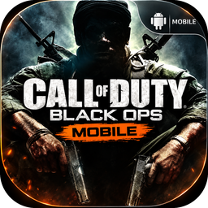

<p align="center"></p>

# Call of Duty Black Ops Mobile

Aplikasi Android (ARM64) untuk menjalankan **Call of Duty: Black Ops versi Nintendo Wii** (ID
`SC7E52`, `SC7P52`, `SC7D52`, `SC7F52`, `SC7I52`, `SC7S52`, `SC7Z52`) di tablet/ponsel Android, dengan
target utama **Xiaomi Pad 6** (Snapdragon 870, Adreno 650).

APK ini **bukan** pembungkus yang membuka aplikasi emulator lain. Core Dolphin (C++, `libmain.so`)
dan lapisan Kotlin-nya dikompilasi langsung ke dalam APK, lalu launcher khusus Black Ops dipasang di
atasnya: pemindai game, HUD FPS layar sentuh, gyro, gamepad, pengaturan grafis/performa, dan manajemen
save.

> File game **tidak** disertakan. Anda harus memakai dump disc Black Ops Wii milik Anda sendiri.
> Proyek ini tidak berafiliasi dengan Activision, Treyarch, Nintendo, atau tim Dolphin.

---

## Status singkat (jujur)

| Bagian | Status |
|---|---|
| APK ARM64 terpasang, launcher terbuka, core Dolphin termuat | Diuji otomatis di CI (emulator Android) — lihat [Pengujian](#pengujian) |
| Pemindaian folder + validasi file oleh DiscIO Dolphin | Diuji otomatis (image sintetis) |
| Pengaturan grafis/performa ditulis ke konfigurasi Dolphin | Diuji (unit test pemetaan nilai); diterapkan lewat `NativeConfig` saat peluncuran |
| Kontrol sentuh, gyro, gamepad → input Wii emulasi | Logika diuji unit test; terhubung ke `InputOverrider` Dolphin |
| **Black Ops benar-benar berjalan di Xiaomi Pad 6** | **Belum diverifikasi.** Saya tidak punya perangkat fisik maupun file game. Perlu diuji di perangkat Anda. |

Dolphin sendiri menjalankan banyak game Wii dengan baik di Snapdragon 870, tetapi performa dan
kestabilan *game ini* di perangkat Anda belum pernah saya ukur. Jangan anggap tabel di atas sebagai
klaim bahwa game sudah lancar.

---

## Backend: kenapa Dolphin, bukan rekompilasi statis

Permintaan awal adalah rekompilasi statis PowerPC Broadway → ARM64 jika memungkinkan. Hasil riset:

- Rekompiler statis untuk kode GameCube/Wii yang ada saat ini hanya menerjemahkan **CPU** (kode
  DOL/REL → C/LLVM). Game Wii juga membutuhkan GPU Hollywood/GX, DSP audio, IOS (filesystem, USB,
  Bluetooth Wii Remote), DVD, dan timing VI. Tidak ada runtime open-source yang menyediakan semua itu
  untuk Android, dan tidak ada proyek rekompilasi untuk Black Ops.
- Membuat runtime tersebut sendiri sama dengan menulis ulang sebagian besar emulator Wii, untuk satu
  game, tanpa file game untuk diuji. Itu tidak realistis di sini.
- **Dolphin** aktif dikembangkan, open-source (GPL-2.0+), punya build Android ARM64 resmi, backend
  Vulkan dan OpenGL ES, dukungan driver kustom (Turnip via libadrenotools), dan JIT ARM64.

Jadi backend yang dipakai adalah **emulasi Dolphin**, bukan rekompilasi. CPU PowerPC dijalankan oleh
**JIT ARM64** Dolphin: kode Broadway diterjemahkan ke ARM64 *saat runtime* (rekompilasi dinamis). Ini
berbeda dari rekompilasi statis dan aplikasi menyebutnya apa adanya.

Arsitekturnya modular: `backend/GameBackend.kt` adalah antarmuka; `DolphinBackend` adalah
implementasi aktif dan `StaticRecompBackend` adalah tempat untuk runtime rekompilasi di masa depan
(saat ini melaporkan dirinya "belum tersedia" beserta alasannya, tidak berpura-pura berjalan).

### Cara integrasi dengan Dolphin

Repositori ini tidak menyalin seluruh Dolphin. Build CI melakukan:

1. Clone Dolphin tag **2609a** (commit dipatok di `dolphin.version`) beserta submodule.
2. Menerapkan `patches/0001-codblackops-dolphin-integration.patch`:
   - `applicationId` → `com.codblackops.mobile`, nama aplikasi, hanya ABI `arm64-v8a`.
   - `LauncherActivity` launcher ini menjadi aktivitas utama (layar daftar game Dolphin disembunyikan).
   - Hook di `EmulationActivity` untuk memasang HUD Black Ops, gyro, gamepad, monitor suhu.
   - Overlay sentuh bawaan Dolphin dikosongkan saat HUD launcher aktif (agar tidak berebut input).
   - **Tambahan core C++**: `InputOverrider` bisa mengendalikan gerakan *shake* Wii Remote dan
     Nunchuk (ID kontrol 56–61). Dipakai untuk aksi yang di game ini dilakukan dengan menggoyang
     controller (misalnya isi ulang dengan goyang Nunchuk).
3. Menyalin source launcher (`app/src/main/java/com/codblackops/...`) dan resource ke modul app
   Dolphin, lalu `./gradlew :app:assembleRelease`.

Input dari launcher masuk ke game lewat API asli Dolphin `InputOverrider.setControlState(...)`
(Wii Remote IR/tombol/shake, Nunchuk stick/C/Z/shake, Classic Controller stick/tombol/trigger).
Pengaturan ditulis lewat `NativeConfig` ke layer dasar Dolphin sebelum game dimulai, lalu game
dijalankan dengan `EmulationActivity` Dolphin.

---

## Instalasi

1. Unduh APK terbaru dari halaman **Releases** repo ini (`CODBlackOps-Mobile-v0.1.N-arm64-v8a.apk`)
   atau dari artifact GitHub Actions.
2. Pasang (izinkan "instal dari sumber tidak dikenal").
3. Buka **Call of Duty Black Ops Mobile** → tab **Game** → **Izinkan akses folder** (Android 11+:
   "Akses semua file") **atau** **Pilih folder (SAF)**.
4. Salin dump game ke `/storage/emulated/0/CODBlackOps` (boleh di subfolder, sampai 3 tingkat), lalu
   tekan **Pindai ulang**.
5. Game dengan status **SIAP** bisa dijalankan dengan tombol **MAIN**.

Dolphin membuat NAND Wii virtual sendiri; Black Ops tidak memerlukan dump NAND/BIOS untuk boot.

### Format file yang dikenali

| Format | Ekstensi | Catatan |
|---|---|---|
| ISO mentah | `.iso`, `.gcm` | |
| WBFS | `.wbfs` | header divalidasi (sector shift, disc header) |
| RVZ / WIA | `.rvz`, `.wia` | format kompresi Dolphin |
| GCZ | `.gcz` | |
| CISO | `.ciso` | |
| NKit | `.nkit.iso`, `.nkit.gcz` | dideteksi; diberi peringatan karena NKit bisa bermasalah |

Setiap file diperiksa dua tahap: (1) header dibaca oleh parser launcher (format, ID game, region);
(2) file dibuka oleh **DiscIO Dolphin** (`GameFile.parse`). Hanya file yang lolos keduanya dan ber-ID
Black Ops Wii yang bisa dijalankan. Status yang mungkin muncul: `SIAP`, `SIAP (PERINGATAN)`,
`MENUNGGU VALIDASI`, `GAME LAIN`, `DITOLAK BACKEND`, `TIDAK VALID`.

---

## Folder dan save

| Lokasi | Isi |
|---|---|
| `/storage/emulated/0/CODBlackOps` | File game Anda (dipindai otomatis) |
| `/storage/emulated/0/CODBlackOps/Save/<GAMEID>/data` | Cermin save Wii terbaru |
| `/storage/emulated/0/CODBlackOps/Save/Backups` | Backup ZIP berstempel waktu (rotasi otomatis) |
| `/storage/emulated/0/CODBlackOps/Logs` | Log diagnostik yang diekspor |

Save asli game ada di NAND Dolphin (`Wii/title/00010000/<hex ID>/data`). Launcher:
- sebelum main: jika NAND kosong tetapi ada cermin di folder Save (mis. setelah instal ulang),
  save dipulihkan otomatis;
- setelah sesi selesai: save disalin ke folder Save dan dibackup;
- tab **Save**: backup manual, pulihkan dari backup mana pun, impor/ekspor, hapus backup.

Jika Anda memakai folder SAF (tanpa izin "semua file"), cermin dan backup ditulis ke subfolder `Save`
di folder SAF tersebut.

Pengaturan grafis dan performa bisa disimpan **per game ID** (profil khusus per region).

---

## Kontrol

Black Ops Wii mendukung **Wii Remote + Nunchuk** dan **Classic Controller (Pro)**. Launcher memilih
controller emulasi sesuai mode:

| Mode | Controller yang dilihat game | Membidik |
|---|---|---|
| **Touch FPS** | Classic Controller | geser layar kanan atau analog kanan |
| **Wii Pointer** | Wii Remote + Nunchuk | sentuhan menggerakkan pointer IR (relatif/absolut) |
| **Gyroscope** | Wii Remote + Nunchuk (atau Classic) | memiringkan/memutar perangkat |
| **Gamepad** | Classic Controller | analog kanan gamepad (+ gyro opsional) |

Tombol HUD: analog gerak (bisa melayang), analog/area kamera, **Tembak** (kanan dan kiri), **ADS**,
**Isi ulang**, **Aksi/Interaksi** (tahan), **Granat lethal**, **Granat taktis**, **Pisau/melee**,
**Lompat**, **Jongkok/tiarap**, **Lari** (tahan atau toggle), **Ganti senjata**, **Ganti cepat**,
**Killstreak**, **Pause (menu game)**, **Skor**, plus tombol launcher: **Menu emulator** (save state,
keluar), **Campaign/Multiplayer** (ganti tata letak), **Gyro on/off**, **Pusatkan bidikan**.

Fitur:
- Editor tata letak layar penuh: geser, ubah ukuran, ubah transparansi, tampil/sembunyikan per tombol.
- Tata letak terpisah **Campaign** dan **Multiplayer**; preset **Xiaomi Pad 6** (tombol diperbesar dan
  ditempatkan untuk jempol pada layar 11" 16:10) dan preset ponsel.
- Sensitivitas X/Y, dead zone, anti-dead zone, akselerasi kamera, smoothing, invert Y.
- Tembak **tap** atau **hold**; drag di tombol tembak sambil membidik; ADS tahan/toggle.
- Gyro: sensitivitas X/Y, sumbu yaw/roll, invert, dead zone, **kalibrasi bias** (letakkan perangkat
  diam), gyro sebagai bantuan bidik di mode sentuh.
- Gamepad Bluetooth/USB: pemetaan tombol bisa direkam ulang (tekan tombol di gamepad), sumbu analog
  kanan Z/RZ atau RX/RY, dead zone, HUD otomatis tersembunyi saat gamepad dipakai.
- Tabel pemetaan **aksi → tombol Wii** bisa diubah per skema, agar cocok dengan pengaturan kontrol
  di dalam game (Options > Controls).

Pemetaan bawaan Wii Remote + Nunchuk mengikuti tata letak default yang dilaporkan pemain (pointer =
bidik, B = tembak, Z = ADS, C = jongkok/tiarap, A = lari, goyang Nunchuk = isi ulang, D-pad atas =
lompat, D-pad bawah = pisau, D-pad kanan = ganti senjata, + / − = granat, 1 = menu, 2 = skor).
Pemetaan Classic Controller mengikuti gaya konsol (ZR tembak, ZL bidik, R/L granat). Karena game
mengizinkan kustomisasi penuh, cocokkan tabel di tab Kontrol bila Anda mengubah tata letak di game.

**Indikator HUD amunisi/reload/arah pandang dari memori game: tidak diimplementasikan.** Itu
memerlukan alamat RAM Black Ops Wii yang belum terdokumentasi; HUD bawaan game tetap tampil seperti
biasa. Launcher hanya menampilkan status input (ADS/lari terkunci, gyro aktif, mode tata letak).

---

## Pengaturan grafis

Semua nilai di bawah ditulis ke kunci konfigurasi Dolphin yang sebenarnya. Opsi yang tidak bisa
dipenuhi backend ditampilkan nonaktif beserta alasannya.

| Opsi | Nilai | Kunci Dolphin / catatan |
|---|---|---|
| Resolusi internal | 480p, 720p, 1080p | `GFX/Settings/InternalResolution` = 1x, 2x, 3x |
| | 900p — **nonaktif** | Dolphin hanya mendukung kelipatan bulat 640×528; 900p ≈ 2,5x tidak ada |
| FPS limit | 30 | Black Ops Wii berjalan 30 FPS |
| | 45 / 60 — **nonaktif** | Batas frame Dolphin mengubah *kecepatan* game, bukan frame rate; 60 FPS butuh patch game yang tidak ada |
| Kualitas tekstur | **nonaktif** | Tekstur adalah aset game; Dolphin tidak punya kualitas tekstur. Tersedia: filter anisotropik dan tekstur kustom (resource pack) |
| Kualitas bayangan | **nonaktif** | Bayangan dirender oleh game; ketajamannya ikut resolusi internal |
| Anti-aliasing | Mati, FXAA, MSAA 2x, MSAA 4x | `MSAA`, FXAA = shader pasca-proses `FXAA` |
| Anisotropic filtering | Mati, 2x, 4x, 8x, 16x | `Enhancements/MaxAnisotropy` |
| V-Sync | Aktif/Nonaktif | `Hardware/VSync` |
| Shader cache | Aktif/Nonaktif | `Settings/ShaderCache` |
| Backend GPU | Vulkan, OpenGL ES | `Core/GFXBackend` |
| GPU driver | Sistem, Turnip | Turnip dipasang lewat libadrenotools Dolphin; bisa diunduh langsung dari rilis K11MCH1/AdrenoToolsDrivers atau dipilih dari file ZIP. Hanya aktif di Vulkan dan GPU Adreno |
| Aspect ratio | Otomatis, 16:9, 16:10 | `AspectRatio` Auto / ForceWide / Custom 16:10 |
| Fullscreen | Aktif/Nonaktif | mode imersif Android + `ExpandToCutoutArea` |
| Preset | Very Low … Ultra | mengubah resolusi, AA, AF sekaligus |
| Reset to Default | | mengembalikan semua opsi grafis |

## Optimasi Android dan profil performa

| Profil | Isi |
|---|---|
| **Hemat Baterai** | resolusi dikunci 480p, tanpa MSAA, AF ≤ 2x, V-Sync, shader asinkron, mode kinerja berkelanjutan |
| **Seimbang** (default) | ubershader asinkron (hybrid), backend multithreading, dual core, mode kinerja berkelanjutan |
| **Performa** | shader asinkron tanpa menunggu, V-Sync mati, semua hack kecepatan |
| **Kompatibilitas** | Sync GPU, shader sinkron + ubershader, akses EFB dari CPU aktif |

Lainnya: pilihan CPU core (JIT ARM64 / cached interpreter), clock CPU emulasi, *thermal guard*
(resolusi diturunkan sementara ke 1x saat Android melaporkan suhu berat), *memory guard*
(peringatan sebelum main bila RAM tersedia rendah, untuk mencegah crash kehabisan memori). Tab **Diagnostik** menampilkan info perangkat/GPU/driver, log launcher,
mengaktifkan log Dolphin per kategori (Video, Host GPU, JIT, DVD, Wiimote, dll.), overlay FPS/frame
time, dan ekspor semua log ke `CODBlackOps/Logs`.

---

## Build sendiri

Kebutuhan: Linux/macOS, JDK 21, Android SDK + NDK `30.0.15729638`, CMake ≥ 3.25, ±15 GB disk.

```bash
git clone https://github.com/aldiianshr-commits/CODBlackOps-Mobile.git
cd CODBlackOps-Mobile
bash scripts/local_test.sh               # unit test logika launcher (cukup JDK)
bash scripts/prepare_dolphin.sh          # clone Dolphin 2609a + patch + salin launcher ke build/dolphin
cd build/dolphin/Source/Android
./gradlew :app:assembleRelease           # APK di app/build/outputs/apk/release/
```

CI (`.github/workflows/build-apk.yml`) melakukan hal yang sama di setiap push ke `main`, menerbitkan
APK sebagai *pre-release*, lalu menjalankan smoke test di emulator.

### Tanda tangan APK

Agar setiap build bisa dipasang sebagai update, CI menandatangani dengan kunci uji yang ada di
`keystore/` (**publik**, jangan dipakai untuk distribusi luas). Untuk kunci pribadi, tambahkan secret
repo `RELEASE_KEYSTORE_B64` (keystore dalam base64), `RELEASE_STORE_PASS`, `RELEASE_KEY_ALIAS`,
`RELEASE_KEY_PASS`; CI akan otomatis memakainya. Mengganti kunci berarti APK lama harus di-uninstall
dulu (save tetap aman di folder `CODBlackOps/Save`).

---

## Pengujian

Yang diuji otomatis di setiap build:

1. **Unit test logika** (JDK murni dan JUnit via Gradle): parser header ISO/WBFS/RVZ/WIA/GCZ/CISO/NKit,
   aturan kompatibilitas, pemetaan grafis/performa → kunci Dolphin, opsi tidak didukung, preset dan
   reset, input (state machine tombol, toggle, pulse, long-press, shake), matematika stick/aim/gyro,
   pemetaan gamepad, serialisasi tata letak, rotasi backup save.
2. **Kompilasi penuh** core Dolphin C++ + Kotlin launcher → APK ARM64, diverifikasi berisi
   `lib/arm64-v8a/libmain.so`, file `Sys`, dan `LauncherActivity` sebagai aktivitas peluncur.
3. **Smoke test emulator** (Android 11 x86_64 dengan translasi ARM64): instal APK, beri izin akses
   file, salin image sintetis (header GameCube valid, WBFS rusak, data acak, file non-disc), buka
   aplikasi, tunggu inisialisasi Dolphin, lalu cek: core termuat, folder Save dibuat, 3 kandidat
   dipindai, image GameCube dibuka DiscIO Dolphin dan dinilai "GAME LAIN", image rusak "TIDAK VALID",
   file non-disc diabaikan, tab Grafis/Kontrol/Performa tampil, tanpa crash Java maupun native.
   Bukti (UI dump, screenshot, logcat) tersimpan di branch `ci-smoke` dan artifact Actions.

Yang **belum** bisa diuji di sini:
- Boot dan gameplay Black Ops (tidak ada file game; emulator x86 dengan translasi ARM tidak cocok
  untuk JIT Dolphin).
- Performa nyata, suhu, dan konsumsi baterai di Xiaomi Pad 6.
- Driver Turnip pada Adreno 650 nyata, gyro dan gamepad fisik.

Laporan dari perangkat Anda (log dari tab Diagnostik → Ekspor) adalah langkah berikutnya untuk
menyetel default.

## Batasan teknis yang diketahui

- Backend adalah emulasi (JIT), bukan rekompilasi statis; lihat alasan di atas.
- 900p, 45/60 FPS, kualitas tekstur, dan kualitas bayangan tidak tersedia (alasan di tabel grafis).
- Indikator amunisi/reload/arah dari memori game tidak ada.
- Multiplayer online asli Black Ops Wii bergantung pada server Nintendo WFC lama; tidak diurus aplikasi ini.
- Pemetaan default Wii Remote berasal dari laporan pemain, bukan manual resmi; sesuaikan di tab Kontrol.

## Lisensi

Kode di repositori ini dan APK hasil build dirilis di bawah **GPL-2.0-or-later** (lihat `LICENSE`),
karena APK menyertakan Dolphin Emulator (© Dolphin Emulator Project, GPL-2.0+). Source Dolphin yang
dipakai: tag `2609a` di https://github.com/dolphin-emu/dolphin + patch di `patches/`.
"Call of Duty" dan "Black Ops" adalah merek dagang Activision; "Wii" adalah merek dagang Nintendo.
